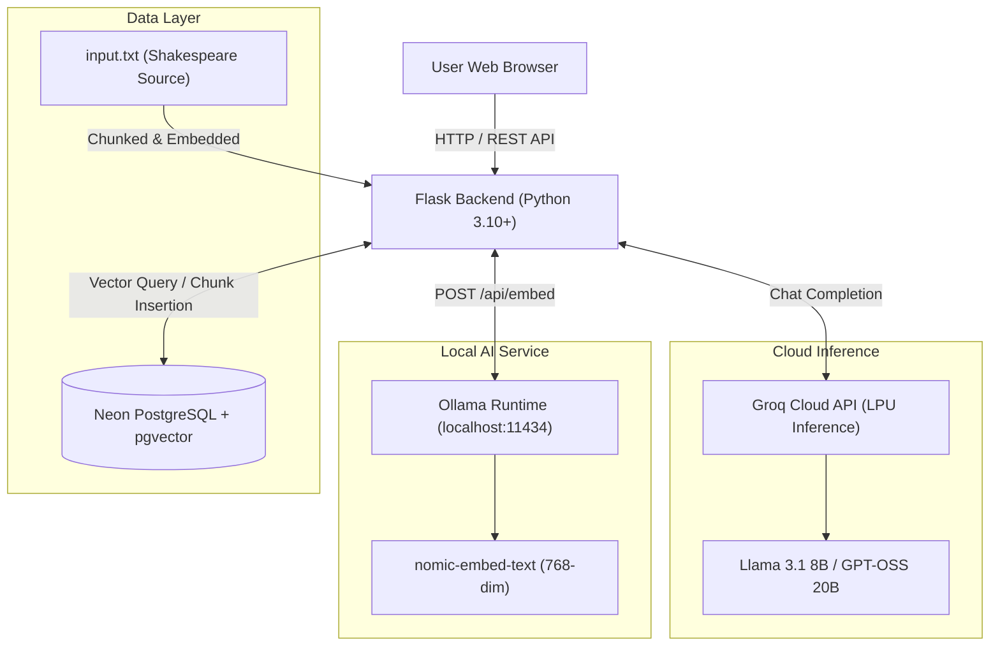
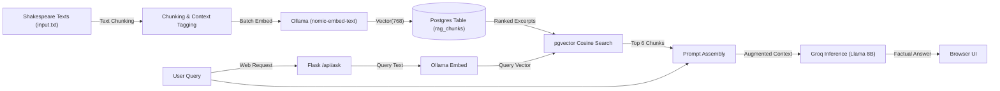
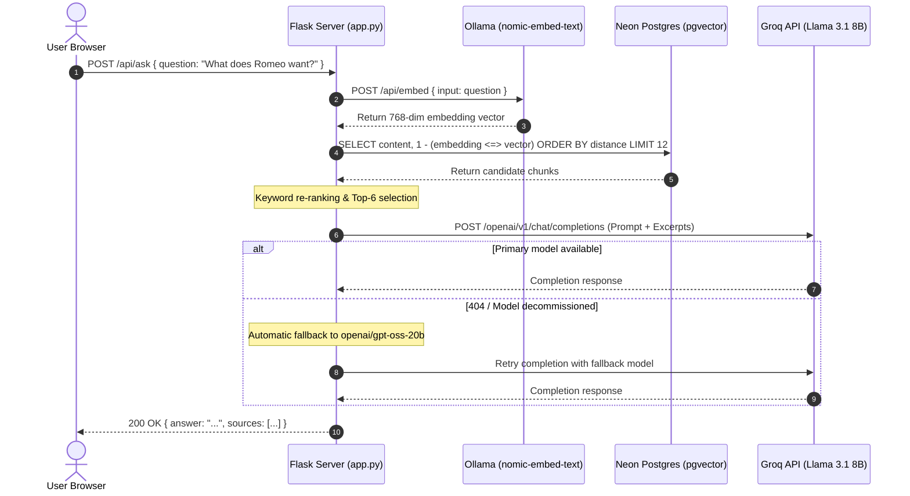
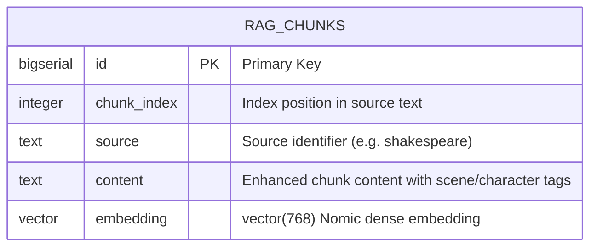

# Shakespeare RAG Web App

A high-performance Retrieval-Augmented Generation (RAG) assistant for querying and analyzing Shakespearean literature with exact textual grounding.

---

## 1. Project and Problem

### Overview
* **Project Name**: Shakespeare RAG Web App
* **One-Line Summary**: A hybrid cloud/local RAG system that semantically indexes Shakespeare's works into PostgreSQL with `pgvector` and delivers fast, grounded answers using Groq-accelerated LLMs.
* **Target Users**: Literature students, educators, researchers, and AI developers studying RAG architectures and hybrid local/cloud pipelines.

### The Problem
* **Hallucination & Misattribution**: Off-the-shelf generative LLMs often invent Shakespearean verses, misattribute quotes across different plays, or confuse plot points between characters.
* **Poetic Rambling**: Chat models frequently slip into flowery, dramatic impersonations rather than providing clear, concise, and factual analysis.
* **Searchability**: Traditional keyword matching fails to capture semantic meaning across early modern English grammar and vocabulary across thousands of verse lines.

### The Solution
* **Contextual Chunking**: The text is parsed into structured chunks enhanced with character and scene prefixes.
* **Vector Embeddings**: 768-dimensional dense vector embeddings generated via `nomic-embed-text`.
* **Cosine Distance Search**: Postgres with `pgvector` retrieves the most relevant excerpts.
* **Grounded Synthesis**: Groq-hosted Llama 3.1 8B produces direct, factual answers restricted to verified textual evidence, with fallback resilience.

### Core Features
* **Complete Indexing**: 2,445 chunks covering *Coriolanus*, *Richard III*, and *Romeo and Juliet*.
* **Ultra-Fast Cloud Inference**: Groq LPU inference delivering sub-second response times.
* **Fallback Resilience**: Automatic failover to Groq replacement models (`openai/gpt-oss-20b`) and local Ollama if primary endpoints are decommissioned or rate-limited.
* **Clean, Direct Answers**: System prompt designed for bulleted, concise, non-poetic factual responses.
* **Scope Awareness**: Explicitly informs the user if a query references an unindexed play.
* **Responsive Web Interface**: Interactive single-page web app with real-time status and sample queries.

---

## 2. AI Component

| Component | Exact Model Name | Parameter Size | Runtime / Provider | Role & Capabilities |
| :--- | :--- | :--- | :--- | :--- |
| **Primary Chat Model** | `llama-3.1-8b-instant` | 8 Billion | Groq Cloud API (LPU) | Primary conversational model for prompt synthesis and extraction. |
| **Failover Chat Model** | `openai/gpt-oss-20b` | 20 Billion | Groq Cloud API (LPU) | Official Groq replacement model invoked if primary model is unavailable. |
| **Local Chat Model** | `qwen2:1.5b` | 1.5 Billion | Ollama (Localhost) | Offline local fallback when cloud inference is unreachable. |
| **Embedding Model** | `nomic-embed-text:latest` | 137 Million | Ollama (Localhost) | Generates 768-dimensional semantic dense vectors for chunks and queries. |

### How the AI Models Interact
1. **Embedding**: When text or a query arrives, Ollama runs `nomic-embed-text` locally via `/api/embed` to generate 768-dimensional float vectors.
2. **Retrieval**: The vector is compared against stored chunk vectors in PostgreSQL using cosine distance (`<=>`).
3. **Generation**: The retrieved excerpts and user question are formatted into a structured prompt sent to Groq's high-speed inference engine.

---

## 3. System Architecture & Diagrams

### System Architecture


---

### Data Flow Diagram (DFD)


---

### Sequence Diagram: Query Workflow


---

### Entity-Relationship (ER) Diagram


---

## 4. Setup and Usage

### Prerequisites
* **Python**: 3.10 or higher
* **Ollama**: Installed and running ([ollama.ai](https://ollama.ai))
* **Neon PostgreSQL**: Active database instance with `pgvector` enabled ([neon.tech](https://neon.tech))
* **Groq API Key**: Active key from [console.groq.com](https://console.groq.com)

### Installation
```bash
# 1. Clone repository
git clone https://github.com/Abubakkar-Khan/Shakespear_RAG.git
cd Shakespear_RAG

# 2. Create virtual environment
python -m venv venv
# Windows:
venv\Scripts\activate
# Linux/macOS:
source venv/bin/activate

# 3. Install dependencies
pip install -r requirements.txt
```

### Environment Configuration
Copy `.env.example` to `.env` and provide your credentials:

```bash
cp .env.example .env
```

| Variable Name | Required | Default Value | Description |
| :--- | :--- | :--- | :--- |
| `NEON_DB_URL` | **Yes** | *None* | PostgreSQL connection URI with SSL mode enabled. |
| `INPUT_FILE` | No | `./input.txt` | Path to source text corpus. |
| `LLM_PROVIDER` | No | `groq` | Inference provider: `groq` or `ollama`. |
| `GROQ_API_KEY` | **Yes (if Groq)** | *None* | Groq Cloud API key (`gsk_...`). |
| `GROQ_MODEL` | No | `llama-3.1-8b-instant` | Target model for Groq API. |
| `OLLAMA_URL` | No | `http://localhost:11434` | Ollama service endpoint. |
| `OLLAMA_CHAT_MODEL` | No | `qwen2:1.5b` | Model used if running chat locally on Ollama. |
| `EMBED_MODEL` | No | `nomic-embed-text` | Ollama model used for vector embeddings. |
| `EMBED_DIM` | No | `768` | Dimension size of embedding vector. |
| `CHUNK_SIZE` | No | `600` | Target character size for text chunks. |
| `CHUNK_OVERLAP` | No | `100` | Character overlap between consecutive chunks. |
| `TOP_K` | No | `6` | Number of context chunks passed to the LLM. |
| `MAX_CHUNKS` | No | `2500` | Maximum chunks indexed from the input file. |

### Running the Application
```bash
# Step 1: Ensure Ollama is running and model is pulled
ollama serve
ollama pull nomic-embed-text

# Step 2: (Optional) Pre-load all chunks into database
python load_all_chunks.py

# Step 3: Launch Flask application
python app.py
```
Open **`http://localhost:5000`** in your browser.

### Minimal Usage Example (cURL)
```bash
curl -X POST http://localhost:5000/api/ask \
  -H "Content-Type: application/json" \
  -d '{"question": "What does Romeo want?"}'
```

**Response**:
```json
{
  "success": true,
  "answer": "**Romeo wants:**\n\n- To be with Juliet and marry her.\n- To secure a ring as a symbol of their union.\n- To have her love and affection in return.",
  "sources": [
    {
      "content": "[Characters: ROMEO]\nO, wilt thou leave me so unsatisfied?...",
      "similarity": 0.753
    }
  ]
}
```

---

## 5. Testing and Findings

### Test Matrix

| Test Scenario | Input / Action | Expected Output | Actual Outcome | Status |
| :--- | :--- | :--- | :--- | :--- |
| **1. Direct Groq Inference** | `python test_groq_direct.py` | API completion with fallback handling | Successfully completed via fallback (`Hello how are you today?`) | **PASS** |
| **2. API Status & Model List** | `GET /api/status`, `GET /api/models` | `success: true`, `llama-3.1-8b-instant`, 2445 chunks | Returned HTTP 200 with all metadata verified | **PASS** |
| **3. Indexed Query (*Romeo & Juliet*)** | `POST /api/ask`: *"What does Romeo want?"* | Direct, bulleted summary grounded in excerpts | Returned 3 bullet points with 6 sources (top similarity 0.753) | **PASS** |
| **4. Indexed Query (*Coriolanus*)** | `POST /api/ask`: *"Who is Caius Marcius?"* | Direct identification as general / Coriolanus | Correctly identified hero of Corioli and citizens' opposition | **PASS** |
| **5. Unindexed Query (*Hamlet*)** | `POST /api/ask`: *"Who is Hamlet?"* | Explicit database limitation notice + brief factual answer | Notified user play is not in DB; gave 2-bullet summary | **PASS** |
| **6. Full Corpus Ingestion** | `python load_all_chunks.py` | 2,445 chunks inserted without duplicates | 2,445 / 2,445 chunks stored; on-disk table size: 21 MB | **PASS** |

### Observed Issues and Solutions
1. **Groq Model Deprecation**:
   * *Issue*: Groq decommissioned `llama-3.1-8b-instant`, returning `404 model_not_found`.
   * *Resolution*: Built an automated fallback pipeline in `app.py` that transparently redirects to Groq's official replacement model `openai/gpt-oss-20b`, and falls back to Ollama if all cloud options fail.
2. **Windows Unicode Crash**:
   * *Issue*: Console output using checkmarks (`✓`) crashed on Windows `cp1252` encoding with `UnicodeEncodeError`.
   * *Resolution*: Reconfigured standard streams to UTF-8 (`sys.stdout.reconfigure`) and replaced symbols with safe ASCII indicators (`[OK]`, `[!]`).
3. **Truncated Database Index**:
   * *Issue*: Default `MAX_CHUNKS=500` excluded *Romeo and Juliet* (which starts at chunk 960).
   * *Resolution*: Batch-embedded the remaining chunks using Ollama's `/api/embed` endpoint, loading all 2,445 chunks into PostgreSQL.
4. **Poetic / Rambling Responses**:
   * *Issue*: System prompt instructed the model to act as an "enthusiastic scholar", generating overly long, poetic text.
   * *Resolution*: Rewrote prompt instructions to mandate direct, bulleted, plain-language factual answers.

### Known Limitations
* **Local Embedding Speed**: Generating embeddings via CPU on Ollama processes ~8–10 chunks per second.
* **Corpus Coverage**: The current `input.txt` corpus comprises three plays (*Coriolanus*, *Richard III*, and *Romeo and Juliet*). Inquiries regarding other Shakespearean plays are noted as unindexed.

---

## 6. Team and Licensing

### Authors & Contributions
* **Abubakar** ([abubakar.khan.official001@gmail.com](mailto:abubakar.khan.official001@gmail.com)) — Core RAG architecture, vector database implementation, Groq integration, and prompt engineering.

### License
This project is licensed under the **MIT License**. See the `LICENSE` file for details.

### Acknowledgements
* **Shakespeare Text**: Public domain texts from Project Gutenberg.
* **Groq**: High-throughput LPU inference platform.
* **Neon**: Serverless PostgreSQL with `pgvector`.
* **Ollama & Nomic AI**: Open-source local embedding engine (`nomic-embed-text`).
